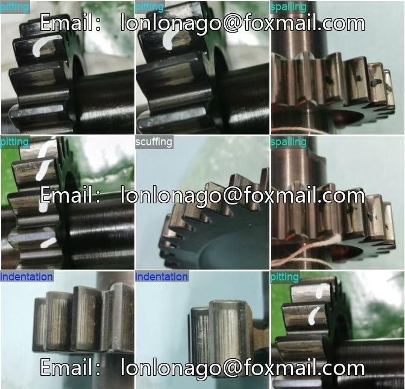
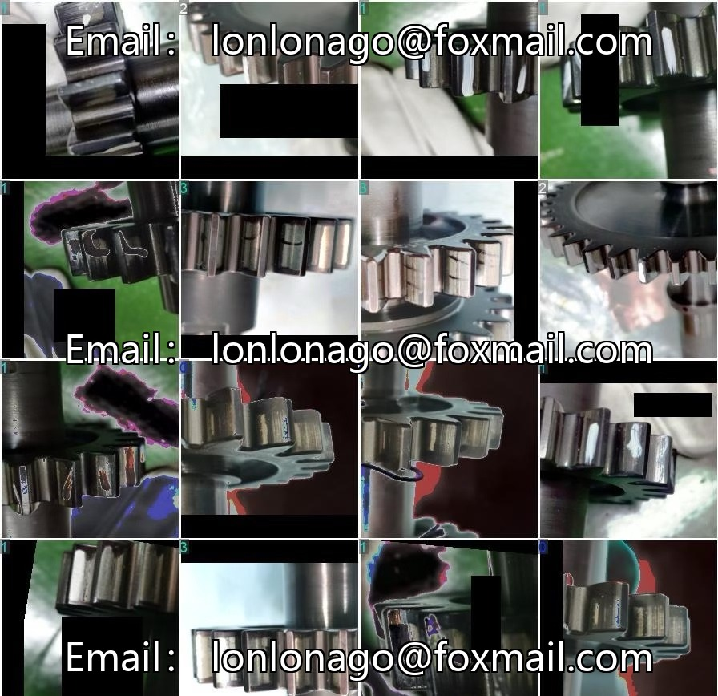

# YOLOv11 gear defect detection model

## Body

YOLOv11 Gear Defect Detection Model - YOLOv11 Gear Defect Classification and Recognition Training Model + Dataset + Interface
This package includes the training model, dataset, and interface code. It supports gear surface defect detection, capable of recognizing typical defects such as breakage, lack, scratch, etc. Suitable for scenarios in manufacturing, quality control, production line management, etc.

The dataset consists of over 7000 images, with more than 16,000 annotations. The formats are Pascal VOC and YOLO. The model supports single image detection, video stream detection, and real-time camera detection. It includes functions such as saving searches, Copilot chat, creating new content, and feedback submission.

Virtual materials, once sold, are non-refundable.
Interested friends, click "I want" to proceed.

## Images

## Payment

Here is a pay link on Stripe ( https://buy.stripe.com/3cs8yP7sY87d0vu9AB ). Please contact me lonlonago@foxmail.com after funding $89, and I will send you a complete data files , thank you!

